# Reference Development & Deconstruction Guide

This directory contains frame-by-frame deconstructions, narrative scripts, audio blueprints, and game engine implementation plans derived from the 3 viral reference videos:
- **`v1/`**: *Tom & Jerry Laser-Shield & Spring Maze* (25.58s)
- **`v2/`**: *4-Character Cast Elimination ("Red Cross OUT") & Hazard Gauntlet* (40.15s)
- **`v3/`**: *Dual-Character Drop & Crest Shield Maze* (25.45s)

---

## 1. Frame-by-Frame Deconstruction & Scripts

### 📺 Video 1 (`/v1`): Tom & Jerry Laser-Shield & Spring Maze (25.58s)
- **Soundtrack:** Trending Brazilian Phonk (*"Montagem - Ela Desce, Ela Sobe"* by DJ Samir), 136 BPM, syncopated 808 sub-bass, cowbell melody.
- **Sound Effects:** Cartoon scream ("Aaaagh!"), "Uh-oh!" vocal drop, laser buzz, Captain America shield ricochet *clank*, spring *boing*, smoke *poof*.

| Timestamp | Extracted Frame | Narrative & Action Script | Visual & Physics Mechanics |
| :--- | :--- | :--- | :--- |
| **0.0s – 2.5s** | `frame_01_1.0s.jpg` `frame_02_3.2s.jpg` | Tom box drops into corridor. Blue laser fires across his path. Tom shows **scared face** (mouth open, wide eyes). Captain America shield is stationed ahead. | Horizontal laser beam. Proximity trigger swaps Tom's face to `scared`. |
| **2.5s – 6.0s** | `frame_03_5.3s.jpg` | Tom grabs the Captain America shield. The laser hits the shield and ricochets safely with a bright spark burst. | Shield attaches to player block front edge. Laser collision reflects beam, plays metallic `shield_block` sound. |
| **6.0s – 10.0s** | `frame_04_7.4s.jpg` `frame_05_9.5s.jpg` | Tom moves past an angry red cat enemy. Drops onto a **green spring bounce pad**. Launched vertically upward. | Enemy box in red frame with hostile scowl. Green bounce pad applies vertical impulse (`vy = -18`). |
| **10.0s – 16.0s** | `frame_06_11.6s.jpg` `frame_07_13.8s.jpg` | Jerry appears below in a protective glass bubble. Tom lands behind Jerry. Two rotating saw blades guard the corridor. | Glass sphere bubble aura. Saw blades rotating at constant angular velocity (`rotate(omega * t)`). |
| **16.0s – 22.0s** | `frame_08_15.9s.jpg` `frame_09_18.0s.jpg` `frame_10_20.2s.jpg` | Tom and Jerry navigate past saws. Jerry's bubble absorbs hazard. They reach the open exit chamber. | Bubble pop particle effect on collision. Camera smoothly follows descending player block. |
| **22.0s – 25.5s** | `frame_11_22.3s.jpg` `frame_12_24.4s.jpg` | Spike the bulldog watches as Tom successfully completes the run. Victory chime over phonk beat. | Level clear screen, stars burst. |

---

### 📺 Video 2 (`/v2`): 4-Character Cast Elimination & Hazard Gauntlet (40.15s)
- **Soundtrack:** Extended Brazilian Phonk mix with heavy 808 distortion, rhythmic vocal chants.
- **Sound Effects:** Character scream, electric sizzle, flame flamethrower whoosh, bomb ticking & explosion, elimination buzzer.

| Timestamp | Extracted Frame | Narrative & Action Script | Visual & Physics Mechanics |
| :--- | :--- | :--- | :--- |
| **0.0s – 4.0s** | `frame_01_1.0s.jpg` `frame_02_4.5s.jpg` | Top HUD displays 4 character avatars: **Spike, Jerry, Tom, Duckling**. Below in the maze, Tom and Duckling drop down with individual green health bars. Red laser beam cuts across. | Top cast bar (active avatars). In-game characters have mini health bars overhead. |
| **4.0s – 9.0s** | `frame_03_7.9s.jpg` | Duckling is struck by the laser / hazard. Duckling takes fatal damage and is eliminated with a smoke poof! | Damage event depletes HP to 0. Elimination sequence. |
| **9.0s – 14.0s** | `frame_04_11.4s.jpg` `frame_05_14.8s.jpg` | **CRUCIAL MECHANIC:** The Duckling avatar at the top right now has a **bold Red Cross ("OUT")** over its face! Spike, Jerry, and Tom continue descending. A flamethrower jet and bomb appear. | **Top HUD updates: eliminated character receives Red Cross overlay.** Surviving cast members stay active. |
| **14.0s – 22.0s** | `frame_06_18.3s.jpg` `frame_07_21.7s.jpg` | Tom grabs a protective bubble. Jerry navigates past a rolling cheese/boulder hazard and electric lightning arcs. | Particle lightning effects, dynamic rolling physics object (`RigidBody2D` circle). |
| **22.0s – 32.0s** | `frame_08_25.2s.jpg` `frame_09_28.6s.jpg` `frame_10_32.1s.jpg` | Spike the bulldog enters the corridor. High-intensity double saw gauntlet. Tom and Jerry maneuver through narrow openings. | Corridors with synchronized reciprocating saw hazards. |
| **32.0s – 40.1s** | `frame_11_35.5s.jpg` `frame_12_39.0s.jpg` | Final surviving characters reach the goal. Dramatic phonk beat drop. | Final scores tallied, remaining survivors celebrate. |

---

### 📺 Video 3 (`/v3`): Dual-Character Drop & Crest Shield Maze (25.45s)
- **Soundtrack:** High-tempo Brazilian Phonk + vocal gasp + metallic ricochet + bounce pad *boing*.

| Timestamp | Extracted Frame | Narrative & Action Script | Visual & Physics Mechanics |
| :--- | :--- | :--- | :--- |
| **0.0s – 3.0s** | `frame_01_1.0s.jpg` `frame_02_3.1s.jpg` | Jerry and Tom drop side-by-side. Both display **terrified expressions** (teeth showing, sweat drops). On the left wall is a vertical **green bounce pad**. | Dual box bodies falling together. Dynamic facial expressions reflect peril. |
| **3.0s – 8.0s** | `frame_03_5.3s.jpg` `frame_04_7.4s.jpg` | Tom hits the wall spring pad. Launched horizontally to the right corridor with a loud cartoon *BOING*. Below sits a golden crest shield inside a cyan bubble. | Wall-mounted trampoline pad applies horizontal impulse (`vx = +16`). Collectible power-up aura. |
| **8.0s – 16.0s** | `frame_05_9.5s.jpg` `frame_06_11.6s.jpg` `frame_07_13.8s.jpg` | Tom collects the crest shield. A protective golden border illuminates his box. Laser beam strikes the shield and harmlessly deflects. | Crest shield attachment. Laser collision detection against shield normal vector. |
| **16.0s – 25.4s** | `frame_08_15.9s.jpg` – `frame_12_24.4s.jpg` | Jerry follows through the cleared safe passage. Both characters land safely at the level terminus. | Safe zone trigger, win celebration. |

---

## 2. Core Audio Architecture: Music + Sound Design

In all three reference videos, the sound is divided into two distinct, high-impact layers:

### Layer A: The Viral Soundtrack (Background Music)
- **Genre:** Brazilian Phonk / Drift Phonk.
- **Key Track in Reference Videos:** *"Montagem - Ela Desce, Ela Sobe"* (DJ Samir).
- **Tempo:** 134 – 140 BPM.
- **Instrumentation:**
  - Distorted 808 sub-bass with slide/glide notes.
  - Phonk cowbell riffs (syncopated pentatonic minor scale).
  - Crisp phonk clap/snare on beats 2 and 4.
  - Vocal chops chanting rhythmically.
- **Mix Level:** Mastered loud (-2 dB to -4 dB peak, high RMS ~8500), ducked slightly (-3 dB) when loud sound effects or vocal drops trigger.

### Layer B: Punchy Cartoon & Meme Sound Effects
1. **Star / Coin Collect:** High-frequency sparkling chime with punchy attack (not a dull 8-bit blip).
2. **Spring Bounce Pad:** Classic cartoon *BOOOING* with pitch-rise vibrato.
3. **Laser Beam:** High-voltage electric arc hum + sharp *PEW/ZAP* discharge.
4. **Shield Block:** High-resonance metallic *CLANG/PING* (Captain America vibranium ricochet).
5. **Saw Blade:** Aggressive mechanical cutting/grinding loop with friction bite.
6. **Damage / Hit:** Comic slap + deep bass impact crunch with screen shake.
7. **Elimination ("OUT"):** Low buzzer / comical defeat scream followed by the Red Cross stamp.

---

## 3. Spider-Maze Game Engine Implementation Blueprint

Based on this analysis, here is how each component maps directly into `C:\Skills\Youtube\MAZE_GAME\spider-maze`:

```mermaid
flowchart TD
    A["Spider-Maze Architecture"] --> B["1. Top HUD System"]
    A --> C["2. 2D Visual Enhancements"]
    A --> D["3. Dual-Layer Audio Engine"]
    A --> E["4. Future Level Mechanics"]

    B --> B1["Hide utility buttons during gameplay"]
    B --> B2["Prominent character cards: Single or Friends VS Enemies"]
    B --> B3["Red Cross 'OUT' stamp when character is defeated"]
    B --> B4["Channel Logo positioned under minimap"]

    C --> C1["3D Beveled Metallic Wall Blocks with 4 corner rivets"]
    C --> C2["Multi-layer Neon Laser Bloom with white core & electric glow"]
    C --> C3["Rounded character tile with depth shadow"]
    C --> C4["Clean mouse cursor during canvas interaction"]

    D --> D1["134 BPM Brazilian Phonk Beat"]
    D --> D2["Punchy cartoon sound effects: star chime, laser zap, shield clank"]

    E --> E1["Level 2+: Green Spring Bounce Pads (Boing launch)"]
    E --> E2["Level 3+: Parachute Drop & Gravity Simulation"]
```

### Component 1: Top HUD Overhaul
- **Pre-Game Screen:** Keep audio toggle, screen aspect radio (9:16 / 16:9), and game instructions on the start menu overlay.
- **In-Game Top Bar:**
  - Remove all utility icons (hamburger, restart, mute button) during active play to keep the video screen clean.
  - **Single Character Mode:** Center a prominent, enlarged character badge (Spider-Man).
  - **Team / VS Mode:** If friends (Spider-Man, Miles, Ghost-Spider) and enemies (Green Goblin, Venom) are present, render them side-by-side with an arcade `"VS"` emblem between them.
  - **Defeat State:** When a character's HP reaches 0, render a bold **Red Cross ($\times$)** over their avatar card with an impact animation.
  - **Channel Watermark:** Place the official circular channel logo (`spider-maze/images/channel_logo_official_circular_1024.png`) neatly beneath the minimap on the right.

### Component 2: 2D Visual Fidelity & Aesthetics
- **3D Metallic Riveted Wall Blocks:**
  - Retain the exact dark blue palette (`#050f33`, `#2c50b8`, `#0f2268`).
  - Render an inner metallic beveled frame with highlight top/left borders and shadow bottom/right borders.
  - Draw 4 metallic silver corner rivets with subtle specular shine.
- **Multi-Pass Neon Laser Beam:**
  - Pass 1: Broad crimson glow with heavy blur (`shadowBlur = B * 0.8`).
  - Pass 2: High-intensity saturated red core (`#ff003c`).
  - Pass 3: Pure white-hot laser center line (`#ffffff`).
  - Pass 4: Random flickering electric sparks at wall emitters.
- **Character Square:**
  - Rounded corners (`radius = B * 0.2`).
  - Deep soft drop shadow under the box.

### Component 3: Audio Overhaul (`make_audio.py` + `audio.js`)
- Re-synthesize the sound bank to output:
  - **Phonk Rhythm Track:** Fast tempo, heavy 808 bass, punchy clap on 2 & 4, syncopated cowbell riff.
  - **Upgraded SFX:**
    - `coin`: Crisp bright chord (1568 Hz, 2093 Hz, 2637 Hz, 3136 Hz) with shimmer decay.
    - `hit`: Heavy comic smack + 50 Hz sub-bass thump.
    - `laser_on` / `laser_hum`: 120 Hz buzzing transformer sawtooth + 4 kHz white-noise sizzle.
    - `shield_block`: High-pitch metallic ping (820 Hz + harmonics) with long metallic ring.
    - `saw_loop`: Dual-tone abrasive saw wave with rhythmic grinding modulations.
    - `bounce`: Classic cartoon rising spring *BOING* (for bounce pads).

---
*Created for Spider-Maze Reference Development and YouTube Shorts Pipeline.*
